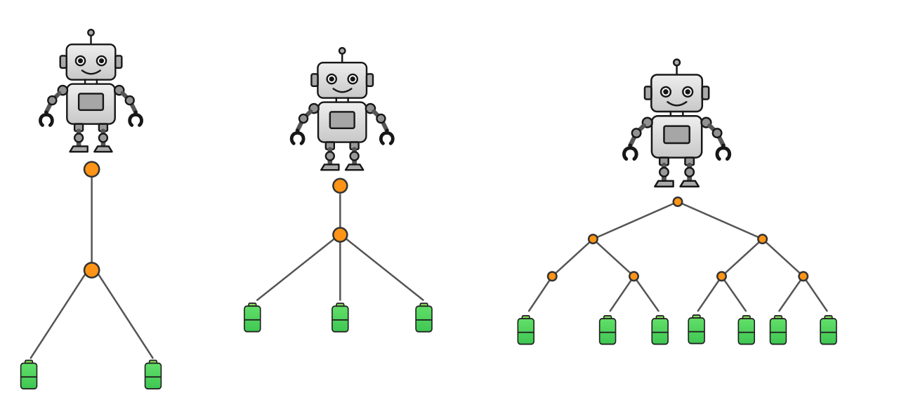

# Grundlegendes Szenario 
Robo, der Roboter, steht am oberen Ende einer verzweigten Struktur, die als Baum bezeichnet wird. An den Enden der Verzweigungen befinden sich Batterien, die Robo einsammeln muss. Wie du an den Abbildungen siehst, kann ein solcher Baum unterschiedlich viele Verzweigungen haben. Welche Gesamtdistanz muss Robo zurücklegen, wenn er alle Batterien einsammelt und dann wieder zu seinem Startpunkt geht? Es wäre praktisch, wenn man dies über eine Regel oder Formel berechnen könnte. 

{width=760}

Dieses Problem gehört zur sogenannten Graphentheorie. Eine grundlegende Idee dieser Theorie ist es, Strukturen als Knoten und Verbindungen zu beschreiben.

**Wichtige Begriffe**

- Baum – die gesamte verzweigte Struktur, in der sich Robo bewegt.
- Knoten – die im Baum eingezeichneten Punkte und die Batterien. Knoten sind also Robos Startpunkt, Verzweigungspunkte und die Batterien.
- Verbindungslinie – verbindet zwei Knoten; entlang dieser Linien bewegt sich Robo, um die Batterien einzusammeln.
- Gesamtdistanz – Anzahl der Verbindungslinien, die Robo auf seinem gesamten Weg zum Einsammeln der Batterien und zurück zum Startpunkt durchläuft.

Nach dieser Einführung in das Problemszenario geht es darum, dass du AILA, dem KI-Lernagenten, beibringst, solche Aufgaben zu lösen. Keine Sorge: Immer bevor du AILA eine Aufgabe erklärst, erhältst du genaue Informationen, um die Aufgabe zu verstehen. 