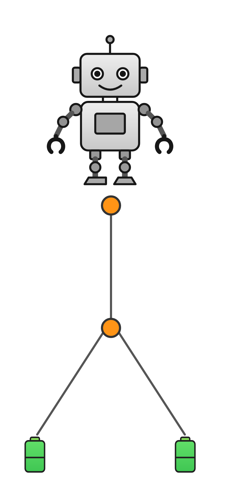

**Bereite dich vor, damit du später AILA alles gut erklären kannst**

Jetzt werden wir die Gesamtdistanz ermitteln, die Robo zurücklegen muss, um alle Batterien einzusammeln. Wir nutzen dazu das Beispiel mit zwei Batterien.

{width=320}

Zur Wiederholung hier die wichtigsten Begriffe: 
- Knoten – die im Baum eingezeichneten Punkte und die Batterien. Knoten sind also Robos Startpunkt, Verzweigungspunkte und die Batterien.
- Verbindungslinie – verbindet zwei Knoten; entlang dieser Linien bewegt sich Robo, um die Batterien einzusammeln. 
- Gesamtdistanz – Anzahl der Verbindungslinien, die Robo auf seinem gesamten Weg zum Einsammeln der Batterien und zurück zum Startpunkt durchläuft.

---

Überlege dir zunächst, wie du A, B und C beantworten würdest. Unten findest du dann die Lösungen.

A. Wie viele Verbindungslinien hat dieser Baum? 
B. Betrachte eine einzelne Verbindungslinie. Wie oft geht Robo über diese Verbindungslinie, wenn er beide Batterien einsammelt und wieder zum Startpunkt zurückkehrt? Begründe deine Antwort.
C. Was ist die Gesamtdistanz, die Robo in diesem Baum zurücklegt?

A. Wie viele Verbindungslinien hat dieser Baum?

**Lösung:** Eine Verbindungslinie geht von Robos Startpunkt bis zum ersten Knoten. Dann noch zwei, welche zu den Batterien führen. Also haben wir insgesamt drei Verbindungslinien.

B: Betrachte eine einzelne Verbindungslinie (z.B. die zwischen Robos Startpunkt und dem ersten Knoten). Wie oft geht Robo über diese Verbindungslinie, wenn er beide Batterien einsammelt und wieder zum Startpunkt zurückkehrt? Begründe deine Antwort.

**Lösung:** Robo benutzt die Verbindungslinie zuerst auf dem Weg zu den Batterien. Da er nach dem Einsammeln der Batterien wieder zum Startpunkt zurückkehren muss, benutzt er dieselbe Verbindungslinie ein zweites Mal auf dem Rückweg. Jede Verbindungslinie wird daher einmal auf dem Hinweg und einmal auf dem Rückweg genutzt. Robo durchläuft jede Verbindungslinie insgesamt zweimal.

C. Was ist die Gesamtdistanz, die Robo in diesem Baum zurücklegt?

**Lösung:** Wir wissen bereits, dass der Baum drei Verbindungslinien hat und Robo jede zweimal durchläuft: einmal auf dem Hinweg und einmal auf dem Rückweg. Die Gesamtdistanz ergibt sich daher aus: 3 Verbindungslinien × 2 Durchläufe = 6. Robo legt in diesem Baum insgesamt eine Distanz von 6 zurück.

