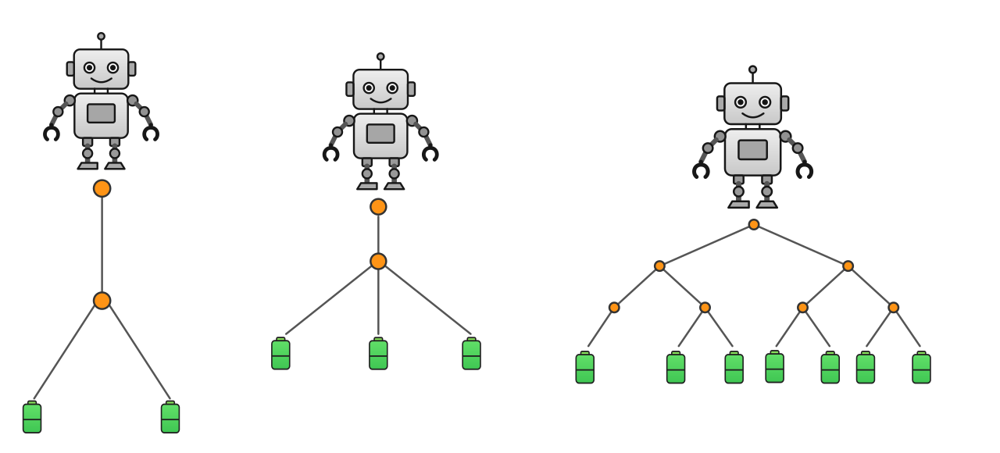

**Bereite dich vor, damit du später AILA alles gut erklären kannst**

Wir haben bereits herausgefunden, wie Robo sich durch den Baum bewegt und wie sich daraus die Gesamtdistanz ergibt. Nun beschäftigen wir uns mit einer weiteren Fähigkeit des Computational Thinking: der **Mustererkennung**. Bei der Mustererkennung geht es darum, wiederkehrende Regeln, Strukturen, Ähnlichkeiten oder Zusammenhänge zu erkennen. Ein Muster ist eine Regel, Struktur oder Beziehung, die sich in verschiedenen Fällen wiederfindet.

Wir gehen zuerst vom Beispiel mit zwei Batterien aus. Wir wissen, dass es **drei** Verbindungslinien im Baum gibt; dass Robo jede einzelne Verbindungslinie **zweimal** durchläuft und die Gesamtdistanz **sechs** beträgt, wenn er die Batterien einsammelt und zum Startpunkt zurückkehrt. 

| Anzahl der Verbindungslinien                   | 3 |
|------------------------------------------------|---|
| Wie oft jede Verbindungslinie durchlaufen wird | 2 |
| Gesamtdistanz                                  | 6 |

Um ein Muster bzw. eine Regel zu erkennen, vergleichen wir nun Bäume mit unterschiedlich vielen Verbindungslinien. Dabei untersuchen wir, wie sich die Gesamtdistanz für Robo verändert, wenn die Anzahl der Verbindungslinien größer wird.

{width=760}

---

Überlege dir zunächst, wie du die Fragen A und B beantworten würdest. Unten findest du dann die Lösungen.

A. Steigt die Gesamtstrecke proportional zur Anzahl der Verbindungen? Überlege dir dazu: Wie groß wäre die Gesamtdistanz bei 14 Verbindungslinien? Und bei 4 Verbindungslinien? Erkennst du ein Muster zwischen der Anzahl der Verbindungslinien und der Gesamtdistanz?
B. Vervollständige den Satz: „Die Regel bzw. das Muster lautet also: Die Gesamtdistanz ist immer \______ mal die Anzahl der Verbindungslinien.“

A. Steigt die Gesamtstrecke proportional zur Anzahl der Verbindungen? Überlege dir dazu: Wie groß wäre die Gesamtdistanz bei 14 Verbindungslinien? Und bei 4 Verbindungslinien? Erkennst du ein Muster zwischen der Anzahl der Verbindungslinien und der Gesamtdistanz?

**Lösung:** Ja, die Gesamtdistanz steigt proportional zur Anzahl der Verbindungslinien. Bei 14 Verbindungslinien beträgt die Gesamtdistanz 28, bei 4 Verbindungslinien beträgt sie 8. Mit jeder zusätzlichen Verbindungslinie steigt die Gesamtdistanz um 2.

B. Vervollständige den Satz: „Die Regel bzw. das Muster lautet also: Die Gesamtdistanz ist immer ______ mal die Anzahl der Verbindungslinien.“

**Lösung:** 2 

