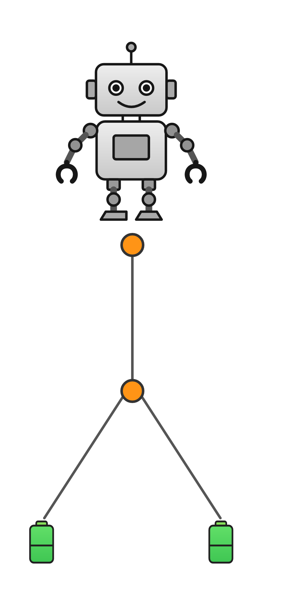

### Information

**Bereite dich vor, damit du später AILA alles gut erklären kannst**

Nun wirst du die Knoten-Formel herleiten. Bisher wissen wir:

- Verbindungslinien-Formel: D = 2 × V
- Anzahl der Verbindungslinien = Anzahl der Knoten − 1

Wir verwenden K für die Anzahl der Knoten. Ersetze V in der Verbindungslinien-Formel durch K − 1, um die Gesamtdistanz nur mithilfe der Anzahl der Knoten zu berechnen.

{width=320}

---

Überlege dir zunächst, wie du die Fragen beantworten würdest. Klicke auf die Fragen, um die Lösungen zu erhalten.

A. Formuliere die Formel für die Gesamtdistanz nur mithilfe der Anzahl der Knoten.

**Lösung:** D = 2 × (K − 1). Die Gesamtdistanz ist zweimal die um eins verringerte Anzahl der Knoten.

B. Warum gilt diese Formel für jeden Baum?

**Lösung:** Ein Baum hat immer eine Verbindungslinie weniger als Knoten. Deshalb ziehen wir zuerst 1 von der Anzahl der Knoten ab. Wir multiplizieren das Ergebnis mit 2, weil Robo jede Verbindungslinie zweimal durchläuft.

