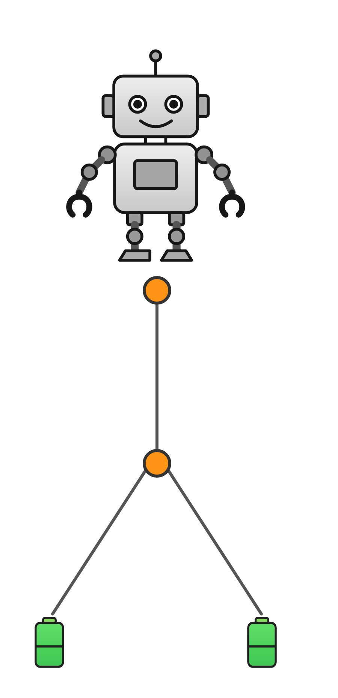
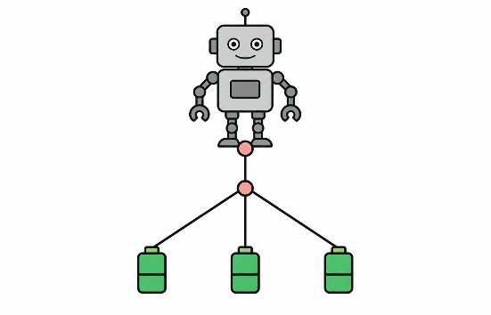

# Information

**Bereite dich vor, damit du später AILA alles gut erklären kannst**

Bisher wissen wir: Ein Baum besteht aus Knoten und Verbindungslinien. Robos Startpunkt, die Verzweigungspunkte und die Batterien zählen als Knoten. Robo durchläuft jede Verbindungslinie zweimal: D = 2 × V.

Ein weiteres Muster verbindet die Anzahl der Knoten mit der Anzahl der Verbindungslinien:

**Anzahl der Verbindungslinien = Anzahl der Knoten − 1**

Ein Baum hat immer eine Verbindungslinie weniger als Knoten.

{width=320}

{width=400}

Überlege dir zunächst, wie du die Fragen beantworten würdest. Klicke auf die Fragen, um die Lösungen zu erhalten.

A. Gilt die Regel auch für die beiden Beispielbäume? Begründe deine Antwort.

**Lösung:** Ja. Der erste Baum hat 4 Knoten und 3 Verbindungslinien. Der zweite Baum hat 5 Knoten und 4 Verbindungslinien. Beide haben genau eine Verbindungslinie weniger als Knoten.

---

# Aufgabe

**Erkläre AILA**

Erkläre AILA, welche Teile eines Baums als Knoten und welche als Verbindungslinien zählen. Erkläre anschließend den Zusammenhang zwischen der Anzahl der Knoten und der Anzahl der Verbindungslinien.

Frage nach, ob AILA alles verstanden hat.

**Stelle AILA nach deiner Erklärung diese Aufgaben:**

A. Gilt die Regel „Anzahl der Verbindungslinien = Anzahl der Knoten − 1“ auch für die beiden Beispielbäume? Begründe deine Antwort.

Prüfe, ob AILA richtig geantwortet hat, und gib Feedback. Wenn du der Meinung bist, dass AILA alles verstanden hat, gehe zum nächsten Thema.
